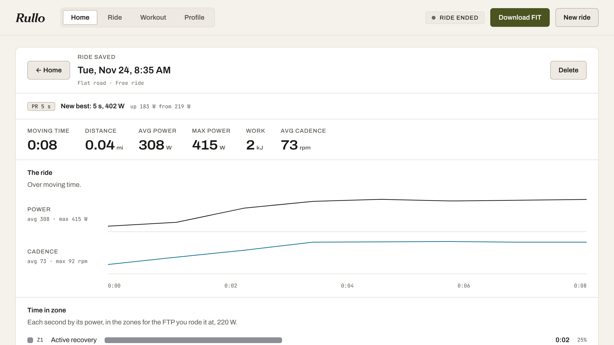
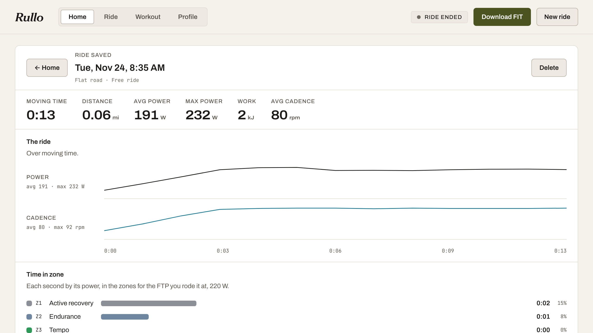
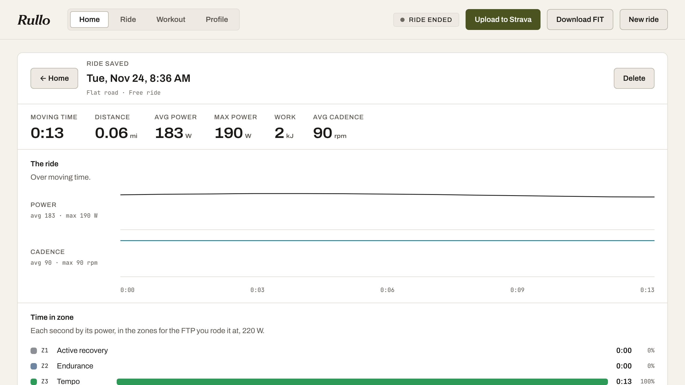

# Finish screen (Nov 24, 2026)

Asked for by Nate on Nov 24, 2026. A ride now has an ending: Confirm end opens the ride's summary, and the summary knows the ride was just finished. Nothing sent to the trainer changed, and how and when a ride is saved did not change. It still needs one real ride, for the reasons under "Needs a real ride".

## What was built

- **Confirm end lands on `#/rides/<id>`.** Only when the ride was saved with something in it. With nothing recorded the rider stays on the Ride tab and reads "Nothing was recorded.", as before.
- **The summary of the ride that just ended is the finish screen.** It is the same page as a summary opened from Home, with three differences:
  - The label "Ride saved" sits over the title.
  - Each PR is written out in a band under the header: the PR chip, "New best: 5 s, 402 W", then "up 183 W from 219 W". A ride with no PR has no band.
  - The page has no Download FIT of its own. The ride's buttons are in the top bar, where they already were: the Strava slot, Download FIT and New ride.
- **It plays once, on arrival.** The "New best" lines and the stats enter 40 ms apart, and the charts are uncovered left to right over 480 ms. Opening the same ride later plays nothing.
- **The Ride tab's ended state is still there.** It has the frozen panel and "Press New ride." as before, plus one notice: "Ride saved" with a Ride summary button.
- **Strava's sign-in comes back to the finish screen.** It used to come back to the Ride tab.
- **New ride on the finish screen goes to the Ride tab.**
- **Deleting the ride that just ended clears its buttons from the top bar.** From its summary or from Home's history.
- **"End and download" of an unfinished ride lands on the summary too.**
- **New code:** `goSummary` in `useRoute.ts`, `prGainsOf` in `history.ts` (each PR with the best it beat), the `finished`, `arrive`, `onArrived`, `notice` and `onDeleted` props on `RideSummaryPage`, `drawIn` on `RideCharts`, `onDeleted` on `HomePage`, and the wiring in `App.tsx`. No new CSS, no new token, no new dependency.

## Calls

- **The one Olive button is in the top bar.** On the finish screen it follows the ended ride's rule, the same as on the ended Ride tab: Upload to Strava (or Check upload) when Strava is connected and the ride is not uploaded, else Download FIT. This covers a fake ride, Strava not set up, not connected, and already uploaded.
- **Download FIT shows once.** The page's own button is dropped on the finish screen, because the top bar's gives the same file. A summary opened from Home keeps its own primary Download FIT, and the top bar is secondary there, as before.
- **"Finish screen" means: the summary on screen is the ride the top bar's buttons belong to.** So it holds when the rider comes back to it from the Ride tab, from Home or from Strava. It ends at New ride or a reload. After a reload the page is a plain history summary.
- **"Once, on arrival" is narrower.** Only the trip straight from Confirm end (or End and download) plays the enter and the draw-in. Back, Forward, the Ride summary button, Home's history, a reload and the return from Strava play nothing.
- **The finish screen waits for the PRs before it draws.** The ride's own numbers and the history are read together, so the "New best" band never pushes the page down after it has appeared. The wait showed as 75 ms from the click to the address change in the checks.
- **The PR lines say the best that was beaten.** "up 183 W from 219 W". The numbers are whole watts, by the same rule as the PR chips.
- **One cover draws in every chart row at once.** It is the course overview's `.ww-draw-in`. The page change itself is not a layout move: View Transitions stay on the Workout tab.
- **Nothing else moves.** No count-up, no growing zone bars, nothing extra for a PR.
- **The Home tab is current in the top bar,** as on every ride summary. ← Home goes to the history, where the ride now is.
- **The browser's Back button goes to the ended Ride tab.** Its Ride summary button comes back.
- **Delete stays in the page header.** It is 71 px below where Confirm end was, so a double click on Confirm end lands on New ride, which is ignored for the first second. Delete also asks twice.
- **Deleting the ended ride is the same as New ride for the top bar.** The ride is gone, so its Download FIT and Upload buttons go, the status pill reads Not connected and the Ride tab is clean.
- **Notices about the ended ride show above the summary.** A FIT file that could not be built and a failed Strava upload were shown only on the Ride tab.
- **The "Ride saved" label is plain `ww-label`.** No state color: nothing here is a connection or a target.

## Checked

Headless Chromium, production build (`vite preview`). Port 4184 was taken by another process, so the checks ran on 4194. Three scripts, 83 checks, all passing.

**Fake trainer (`?fake=1`), 45 checks:**

- Before End: power, cadence, speed, distance and time changed on each of three reads a second apart (105, 159, 201 W). The Ride tab was 720 px tall on a free ride and on Test Hills with Test Intervals. No "Ride saved" notice before End.
- Confirm end landed on `#/rides/1`, 75 ms after the click.
- Totals: the summary read 0:13 and 0.06 mi; the Ride tab at End read 0:12 and 0.06 mi. The one second is the gap between the ride clock and the count of saved samples, which the summary had before this work. Opened from Home, the same ride read the same.
- On arrival `ww-enter` and `ww-draw-in` both ran, and nothing was running 1.2 s later. Coming back from the Ride tab, opening from Home and reloading ran neither, and the cover element was not there.
- A second, harder ride: "PR 5 s New best: 5 s, 402 W up 183 W from 219 W". The first ride had no "New best" text.
- One Olive button, Download FIT, on: the finish screen (plain, PR, course and workout), the ended Ride tab, Home with the ride ended, and the summary after a reload. One Download FIT button on the finish screen.
- Download FIT on the finish screen fired a download (`rullo-2026-11-24-0835.fit`).
- New ride went to `#/ride` with 0.00 mi, 0:00 and Connect.
- A double click on Confirm end: the summary stayed, the ride stayed ended, Delete was not armed. The button under the pointer afterwards was New ride.
- Nothing recorded (stopped pedaling before Start): stayed on `#/ride` with "Nothing was recorded." and no Download FIT.
- Delete on the finish screen: Home, Connect in the top bar, "Not connected", no New ride, two rides left. The deleted ride's address read "Ride not found".
- Back went to the ended Ride tab.
- No sideways scroll at 1280 and 1024.
- Reduced motion: no animation ran on arrival; the cover was already at zero width and every stat at full opacity.
- No console errors.

**Real Bluetooth code with a stubbed trainer and a mock of `/api/strava/*`, 35 checks:** `navigator.bluetooth` was replaced by a stub that sends Indoor Bike Data once a second and answers the control point. Strava's sign-in page was answered by the test. Strava itself was never called.

- Connected, not uploaded: the one Olive button was Upload to Strava. Nothing was sent before the click. It read "Uploading to Strava", "Strava is processing", then View on Strava with `https://www.strava.com/activities/424242`. One upload. Then the one Olive button was Download FIT.
- Not connected: Connect Strava to upload, Download FIT in Olive. The button went to `#/profile/data`. Connect with Strava left for the mocked sign-in and came back to `#/rides/1` with a clean address, "Ride saved", "Ride ended" and Upload to Strava in Olive. No enter or draw-in on the way back. The upload then reached View on Strava.
- Not set up: no Strava text anywhere on the page, Download FIT in Olive.
- No sideways scroll at 1280 and 1024 with the link showing. No console errors.

**Three more:** the automatic FIT download at End still fired once. "End and download" of an unfinished ride landed on its summary.

## Not right, or not sure

- **While an upload is running there is no Olive button** for those seconds: the Strava button is disabled and Download FIT is secondary. It was already so on the Ride tab.
- **The ended Ride tab is taller than before.** With a course and a workout row the "Ride saved" notice makes the page about 790 px tall, so it scrolls at 720. Nothing on it is live. Before End it is unchanged.
- **If closing the ride in storage fails,** the rider lands on "Ride not found". The ride engine reports the ride as ended either way, and how a ride is saved was not to be touched.
- **The Ride tab before End was not compared pixel by pixel with `main`.** The change there is one notice that needs an ended ride.

## Needs a real ride

- End a ride on the Kickr and see the finish screen arrive. Check the charts and the totals against the ride.
- With Strava connected: Upload to Strava from the finish screen, then View on Strava.
- With Strava not connected: Connect Strava to upload, sign in, and land back on the finish screen.

## Not built

- Upload of past rides from Home. The Strava slot is still only for the ride that just ended.
- A share image, a comparison with the last ride on the same course or workout, a note field.
- Anything animated for a PR beyond its line entering with the rest.
