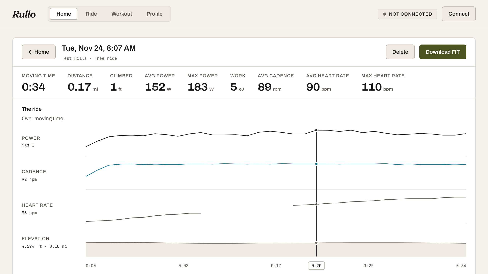
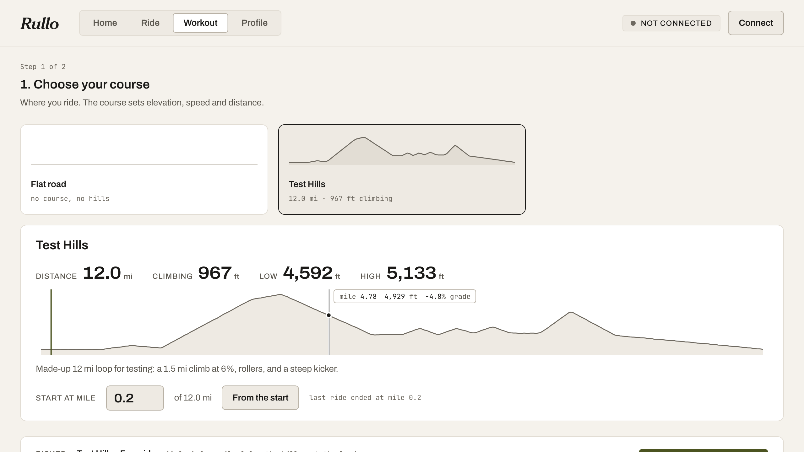

# Scrubbable charts (Nov 24, 2026)

Asked for by Nate on Nov 24, 2026. Two charts now answer the pointer: the ride summary's stacked charts and the course overview's profile on the Workout tab. No trainer code changed and nothing on the Ride tab changed, so there is no ride test.

## What was built

- **Ride summary (`#/rides/<id>`).** Pointing at the charts puts one line through every row at one recorded second. Each row's small mono line, which normally reads "avg 152 · max 183 W", shows that second instead: power in W, cadence in rpm, heart rate in bpm when the ride has it, and on a course ride elevation in ft with the distance ridden in mi. The time into the ride (moving time) is a chip on the time axis, under the line.
- **A second with no reading reads "--".** The heart rate row during a dropped sensor, for example. That row gets no dot for that second.
- **Leaving the charts** puts the ride's numbers back.
- **Keys.** The chart area is one tab stop with the app's 2px focus ring. Left and Right move one second. Shift makes it 10 s. Page Up and Page Down move 60 s. Home and End go to the ends. Escape, or leaving the field, clears the cursor.
- **Screen readers.** The chart area is a slider. Its value text is the whole readout: "0:11 into the ride, power 147 W, cadence 91 rpm, heart rate no reading, elevation 4,593 ft, distance 0.05 mi".
- **Course overview (Workout tab, step 1).** Pointing at the selected course's big profile shows a line, a dot on the profile and one chip: the mile, the elevation in ft and the grade in %.
- **New code:** `src/components/RideCharts.tsx` (the stack and its cursor, moved out of `RideSummaryPage.tsx`), a `cursor` prop on `RideChart`, the hover in `CourseOverview.tsx`, and four small classes in `index.css` (`.ww-scrub-area`, `.ww-scrub`, `.ww-scrub-line`, `.ww-scrub-dot`, plus `.ww-scrub-time` for the chip's place). No new token and no new dependency.

## Calls

- **The readout goes where the numbers already are.** Each row's mono line swaps to the value at the cursor. It lives in the row's fixed 152px label column and truncates, so nothing can move or resize. The longest readout, "12,345 ft · 112.34 mi", is 21 characters and the column holds about 23. One chip for everything would have covered a chart.
- **The time is a chip on the axis.** It is the one value with no row of its own. The chip is the workout strip's (`.ww-strip-tip`), centered on the line and kept inside the axis at both ends. It covers an axis label when it passes over one.
- **The cursor sits on a recorded second, not between two.** The values are that second's, so the line is drawn at that second. On a 34 s ride that is a step of 36px. On an hour's ride it is a third of a pixel and looks continuous.
- **On a long ride the mouse cannot reach every second.** At 1280px wide an hour is about 3.6 s a pixel. The keys reach every second.
- **The dot shows the second's own reading.** On a ride longer than the chart is wide, the drawn line is an average of the seconds in each pixel, so a dot can sit a little above or below the line. The dot agrees with the number in the row. Clamped to the chart.
- **The time counts from 0:00.** The first recorded second reads 0:00 and the last reads one second less than Moving time (0:33 on a 0:34 ride). The axis ends are 0:00 and the moving time, so the last tick is one second past the last cursor position.
- **`fg`, never Olive.** The line is the two-tone outline from DESIGN.md: 1px `fg` with a 1px `surface` hairline on each side. On the course profile Olive is already the start mile.
- **Dots take the line's color** (power `fg`, cadence `cadence`, heart rate `fg-muted`, elevation `fg-subtle`) inside a 2px `surface` ring. On the course profile the dot is `fg`.
- **No easing on the line or the dots.** They are placed with a transform and have no transition. Only the chip fades in, once, over `--ww-dur-fast`, as the strip tip does. With reduced motion that is 0.
- **Focus alone shows no cursor.** A click also gives focus, so a cursor on focus would jump to the start under the mouse. From no cursor, Right starts at the first second and Left at the last.
- **Page Up and Page Down (60 s) were added** beyond what was asked. Ten seconds a press is slow on an hour's ride.
- **Touch is ignored,** as on the workout strip. A tap leaves nothing behind and the page scrolls as before.
- **The course chip sits inside the top of the profile,** beside the line (right, or left when there is no room). Above the profile it would cover the big stats and below it the description. It can cover a peak next to the cursor. It never covers the dot.
- **The course cursor follows the pointer exactly.** Elevation is read between the course's points (`elevationAt`), and grade is `gradeAt`, the same 50 m measure the ride uses. So the last point of a course reads 0.0%, as it does in a ride.
- **No keys on the course profile.** It was not asked for. The mile, feet and grade there cannot be reached without a pointer yet.
- **A crosshair pointer** over the summary's charts. The course profile keeps the plain pointer.

## Checked

Headless Chromium, production build (`vite preview`), `?fake=1`. Rides made with the fake trainer: a 34 s ride on Test Hills with the fake heart rate sensor and one dropped stretch (27 of 34 seconds have heart rate), a 20 s free ride with heart rate, and a 12 s free ride with no sensor.

- **Values match the samples.** At 7 places across each ride (seconds 0, 4, 10, 17, 24, 30, 33 on the course ride), at 1280 and 1024px wide, the row readouts and the time chip equal the saved sample for that second, read straight from IndexedDB. The line is within 0.6px of where that second is drawn.
- **No reading.** Second 11 and second 17 of the course ride have no heart rate: the row reads "--", three dots instead of four.
- **Nothing moves.** The bounding box of every chart row, every cell in it, every section, heading and paragraph, and the page's scroll height and width are identical before, during and after the cursor. Mouse and keyboard, 1280 and 1024.
- **No horizontal scroll** at 1280 and 1024 (scroll width equals the window's).
- **Keys.** Tab reaches the chart area; one tab stop; the ring is 2px solid. Right, Right, Right, Shift + Right, Left, Shift + Left, End, Right, Home, Left gives seconds 0, 1, 2, 12, 11, 1, 33, 33, 0, 0. The readout at second 11 matches the sample. Escape clears. Blur clears.
- **No sensor.** The 12 s ride has two rows, two dots and no heart rate in the readout or the spoken text.
- **An hour.** A copy of the course ride with 3,600 made-up samples (test browser only, removed after): values match at 8 places, the chip stays inside the axis at both ends, Page Up moves 60 s. 200 pointer moves, one a frame, took 3,332 ms: 16.7 ms a frame, so no frame was missed.
- **Course overview.** At 8 places across Test Hills (12.0 mi, low 4,592 ft, high 5,133 ft), 1280 and 1024: the mile is within 0.03 of the place pointed at; the feet are inside low to high; the grade agrees with the rise between two readouts 12px either side (6.1% on the 6% climb at mile 3.24, -5.6% against -4.8% at mile 5.40 where the slope is changing). The line and dot are within 0.6px of the pointer. The chip stays inside the profile and flips to the left near the end. Nothing moves; leaving clears it.
- **Motion.** With motion on, the only animation is the chip's 120 ms fade; the line and dots have none. With `prefers-reduced-motion` nothing animates at all.
- **Touch.** A tap on the charts in a touch context leaves no cursor and throws nothing; `touch-action` is untouched.
- **Console:** no errors on any of these pages.
- **Ride tab.** `?fake=1#/ride` after Connect and Start: power, cadence, speed, distance and time change every second for 12 s. No file of the Ride tab was edited.
- `npm run build` passes. No hex value outside `tokens.css`.

## Not checked

- **A real screen reader.** The slider's value text was read from the page, not heard.
- **A pen, and a real touch screen.** Pen is handled as a mouse in code and was not run. Touch was run with Chromium's emulation only.
- **Other browsers.** Chromium only.
- **A ride with a workout** (the faint interval lines under the cursor) and a ride with a pause. Neither changes how a second is found: pauses take no width in these charts.

## Not built

- Hover on the Ride tab's elevation profile. Asked not to.
- Keys on the course profile.
- Zoom, a selected range, or an average between two points.
- The zone at the cursor, speed, or grade on the summary.
- A cursor on the card graphs or the workout builder.
