# Zwift accounts, profiles and the ride flow: what to build in Weem Watts

Researched 20 Nov 2026 from Zwift support pages, zwift.com, Zwift forums, Zwift Insider and earlier Weem Watts research (`docs/zwift-complaints-research.md`, `docs/zwift-ride-experience-research.md`). Screenshots are in `docs/images/zwift-accounts/`. Version numbers on images (v1.122 etc.) are Zwift game versions; older layouts are marked.

---

## 1. The short version

- **Login:** you must make your own Zwift account (email + password). There is **no** Google, Apple, Facebook or Strava sign-in, and no two-factor login. Strava, Garmin and others are only *connections* for sending rides out.
- **Profile:** name, birthday, country, units, height, weight, gender, FTP, max HR, plus earned stats (level, XP, Racing Score, Training Score, streak, badges). It lives in three places (game, phone app, website) and each one can edit a different set of fields.
- **Past rides:** saved three ways: a FIT file on the computer you rode on, the activity feed on zwift.com and in the Companion phone app (last 250 rides), and auto-upload to Strava or Garmin.
- **After a ride:** three full-screen reports in a row: Ride Report, then Save, then Progress Report. Then back to Home. Strava gets the ride a minute later.
- **For Weem Watts:** skip accounts for now. Build the post-ride summary, a ride history list, a progress card, a "who's riding" picker for a shared trainer, and a backup/export button. Those are the parts riders value that don't need a server.

---

## 2. Logins and accounts

### 2.1 Your questions, answered

| Question | Answer | Source |
|---|---|---|
| Do they log in with Strava? | **No.** Strava is a connection on the Connections page (auto-upload and "find your Strava friends"). Not a login. | zwift.com/sign-in; support "Creating an Account"; Strava help "Zwift and Strava" (21 Sep 2026) |
| Do they log in with Google or Apple? | **No.** The sign-in page has Email, Password, Remember me, Forgotten password, and Create an account. Apple Pay and PayPal show up only when paying. | zwift.com/us/sign-in, checked 20 Nov 2026 |
| Do they make their own Zwift login? | **Yes, required.** Free to create. Can be made on zwift.com, inside the game on iOS/Android, or in the Companion app. | Support "Joining Zwift FAQ", "Creating an Account" |
| Two-factor? | **No.** Riders have asked since 2021. | Forums t/568865 (2021), t/632233 and t/633059 (2024) |
| One account on many devices? | Yes: PC, Mac, iOS at once is allowed, but one ride at a time. Multiple people can share one computer, just not at the same time. | Support "Account FAQ" |

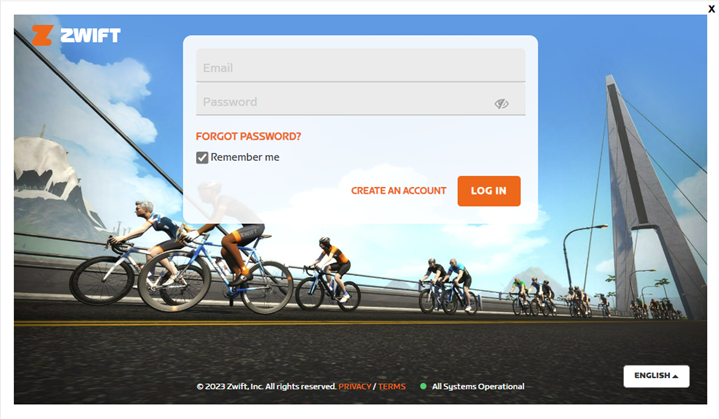
*Desktop launcher: email, password, Remember me, Create an account, Log in. Nothing else.*

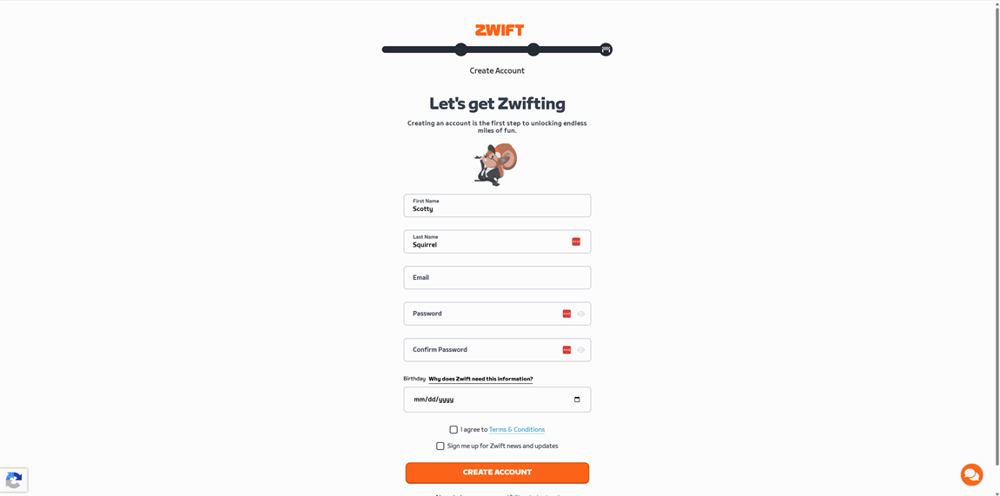
*zwift.com sign-up (Sept 2026 image): first name, last name, email, password twice, birthday, terms, news opt-in. No social buttons.*

### 2.2 Sign-up flow on zwift.com (5 steps, about 10 clicks)

1. **Create Account:** names, email, password x2, birthday (16+), agree to terms, email opt-in → CREATE ACCOUNT
2. **Basic Profile:** Cycling / Running / Both / Triathlon, Metric or Imperial, height, weight, gender → CONTINUE
3. **Connect Training Apps:** Strava, Garmin, Wahoo, Hammerhead (each opens that site's OAuth) → CONTINUE
4. **Equipment Check** and **Weekly Goal** → CONTINUE
5. **Membership:** monthly or annual, payment, or "I'll do this later"

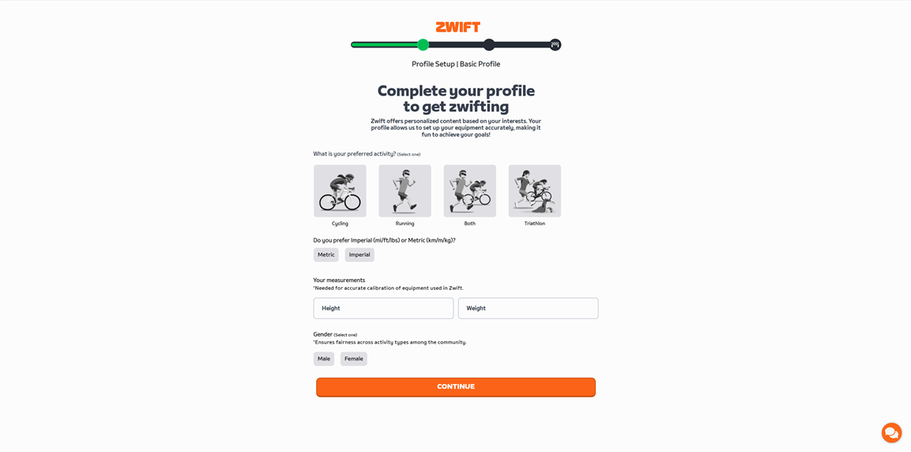
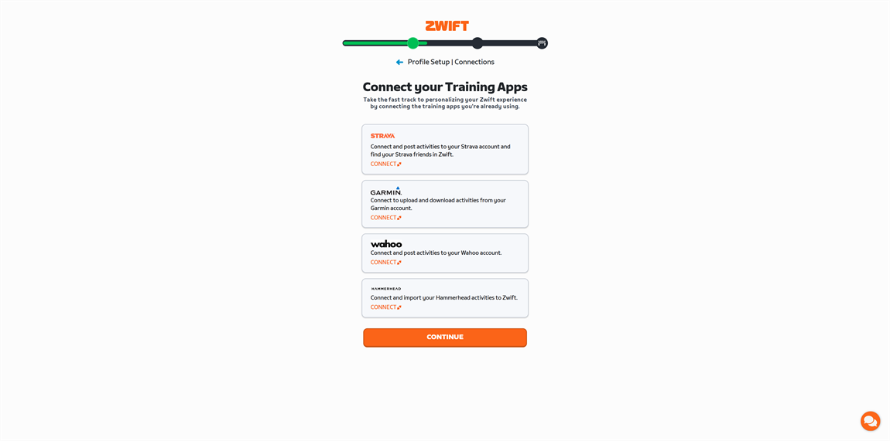
*Step 2 and 3. Note the progress bar at the top and one question group per screen.*

### 2.3 First time opening the game

License agreement → Tell us about yourself → What brings you to Zwift → Paired devices → Gender → Body measurements → Customize avatar → Customize bike → Home. Every launch after that: Launcher (remembered login) → LOG IN → Welcome screen (shows plan status, CHANGE USER, LET'S GO) → Home.

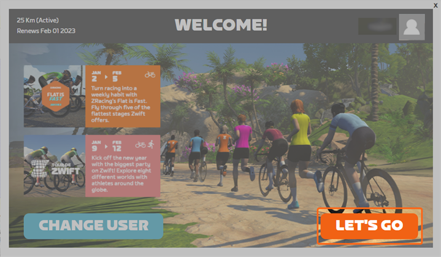
*The Welcome screen after login. "Change user" is how households share one trainer.*

### 2.4 What people complain about with login

| Pain | Evidence |
|---|---|
| Shared trainer, many riders. Apple TV only remembers 2 users, has no log-out button, and once someone logs in the next person can pick their account with no password | Forums t/240296 (2020 to 2024), t/608831 (2023), t/671261 "Zwift for e-cycling clubs" (22 Sep 2026). One club deletes and reinstalls the app after every rider |
| Typing a password with a TV remote pushes people to weak passwords | t/240296 |
| Launcher forgets the password after updates | t/571882 (Jan 2022), t/646468 (Jan 2025) |
| "Failed to log in, check internet connection" with correct details | t/606276 (2023), t/611983 (2023) |
| No 2FA | t/568865, t/632233, t/633059 |
| Family plan (one paid account per rider) | 1,310 votes, forum t/13112 (see complaints doc) |

**Takeaway:** the login hurts most when several people share one trainer. A "pick your rider" screen with no password fixes that for a home setup.

---

## 3. The profile

### 3.1 Where the profile lives

Zwift splits "you" across three places. This is the second most common confusion after connections.

| Field | Game | zwift.com | Companion |
|---|---|---|---|
| Profile photo | - | yes | yes |
| First / last name | yes | yes | yes |
| Gender, date of birth | yes | yes | - |
| Country | yes | yes | yes |
| Units (metric / imperial) | yes | yes | yes |
| Height, weight | yes | yes | yes |
| FTP, max HR, running pace | yes | - | - |

Source: support "Updating Your Public Profile". Weight and height are used for speed and leaderboards; FTP is set by Zwift at first and updated by tests and rides.

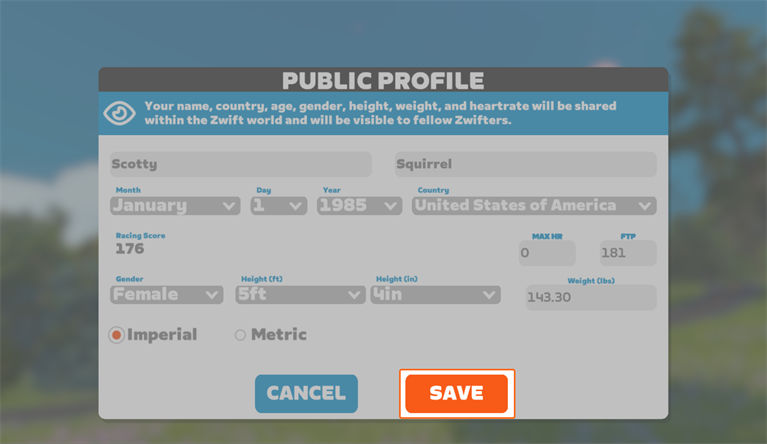
*In-game Public Profile (v1.102). The banner warns that name, country, age, gender, height, weight and heart rate are visible to other riders.*

### 3.2 How you get there

Home → click your initials (top right) → menu: **Achievements, My profile, My settings, Tutorial, Switch to running**. During a ride: MENU → edit icon under your name.

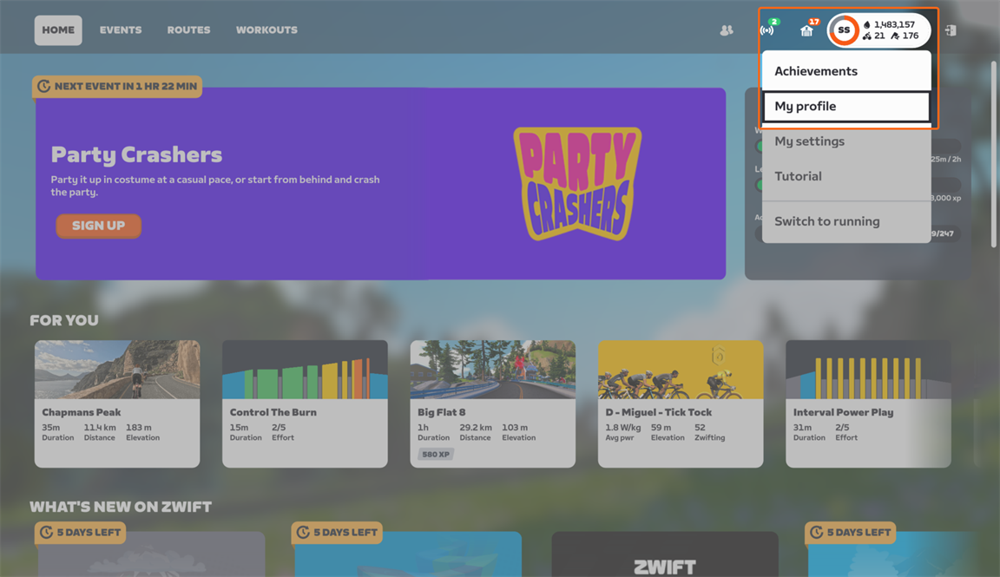
*Home screen (v1.122). The pill top right shows your initials ringed by level progress, Drops (currency) and level.*

### 3.3 Stats tied to the profile

- **Level and XP** (ring around your initials), **Drops** (in-game money for bikes)
- **Achievements** and **route badges** (Home → initials → Achievements)
- **Racing Score** (1 to 1000, sets race category)
- **Training Score, status** (Ready, Fresh, Productive, Overreaching, Detraining), **weekly goal** (kJ, Stress Points, calories, distance or time), **week streak**
- **1-year power bests** at 5 s, 1, 5 and 20 min, plus FTP
- On zwift.com/feed: **Fitness box** with zFTP, zMAP, VO2max and a power curve (all-time vs last 60 days)

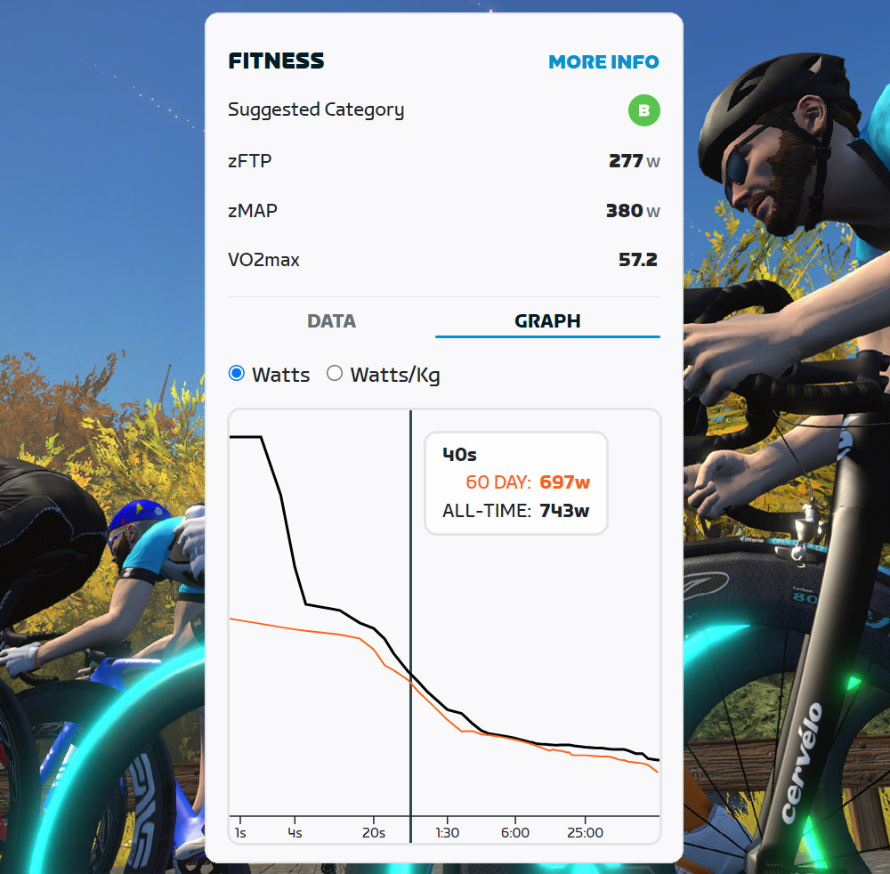
*zwift.com feed, Fitness box (2023): power curve, all-time in black, last 60 days in orange. Simple and very useful.*

**Complaint:** stats are scattered. "A centralized place to see all of my riding stats/accomplishments/badges... seems hard to find, or missing. Seems like a major miss to only show the accomplishments for 5 seconds at the end of a workout." (forum t/630676, May 2024). Zwift staff answered that it's in "different places".

### 3.4 Companion app (phone) home

Redesigned Oct 2026 (v3.91): stats strip at the top (levels, streak, Training Score, Racing Score), friends riding now, today's activity, weekly goal and training score cards, What's New, Explore, recent activities. Bottom tabs: Home, Events, Plan, Clubs, More.

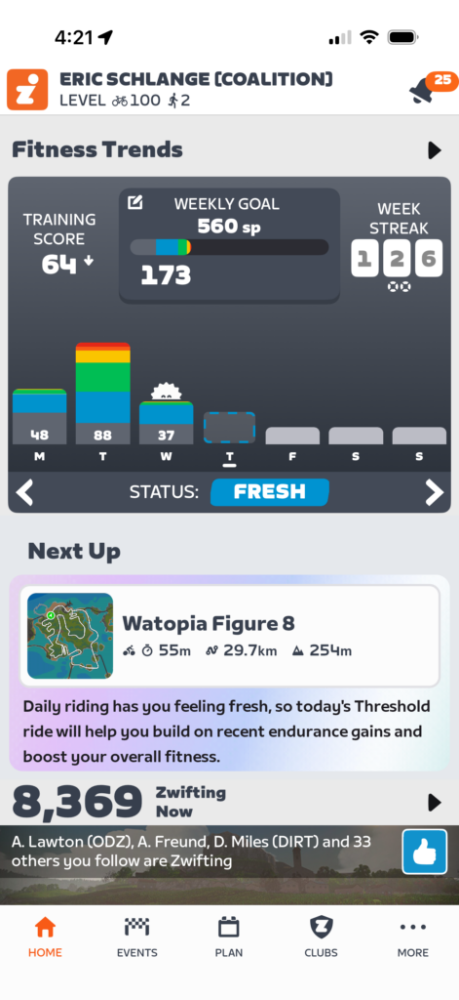
*Companion (Apr 2026): Training Score, weekly goal bar, week streak flip-counter, daily bars, status chip, "Next Up" suggestion.*

Riders want to reorder or hide these panels (forum t/664467, Jan 2026), and some miss small details the redesign dropped (numbers on daily bars, t/672193).

---

## 4. Past rides: where they're saved

| Where | What you can do | Notes |
|---|---|---|
| **The device you rode on** | FIT file per ride. PC: `%LOCALAPPDATA%\Zwift\Activities` (since Feb 2026, before that `Documents\Zwift\Activities`). Mac: `Documents/Zwift/Activities`. iOS/Android: file icon on the title screen, then email it to yourself | The rescue copy when uploads fail |
| **zwift.com/feed** | Everyone / Just Me → open a ride → cog: edit title, visibility (Public, Followers, Private), DOWNLOAD FIT FILE | "Load more" at the bottom |
| **Companion → Activities** | Same list, plus delete (permanent, no undo), comments, Ride Ons, photos | Last **250** activities only |
| **Strava, Garmin, TrainingPeaks, Wahoo, etc.** | Auto-upload once connected | One-way. Rides under 2 km don't upload |

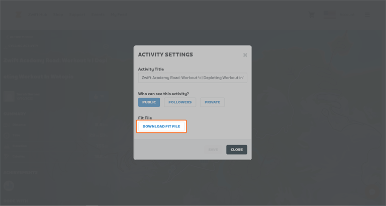
*zwift.com activity settings: title, who can see it, Download FIT. Three things, one dialog.*

**Activity detail page** (Companion, swipe between pages): route map with rider avatars who rode with you, distance / time / elevation / calories, a timeline graph of power, cadence and heart rate over the elevation profile (drag a finger to scrub), power distribution, HR zone distribution, photos, Ride Ons, comments.

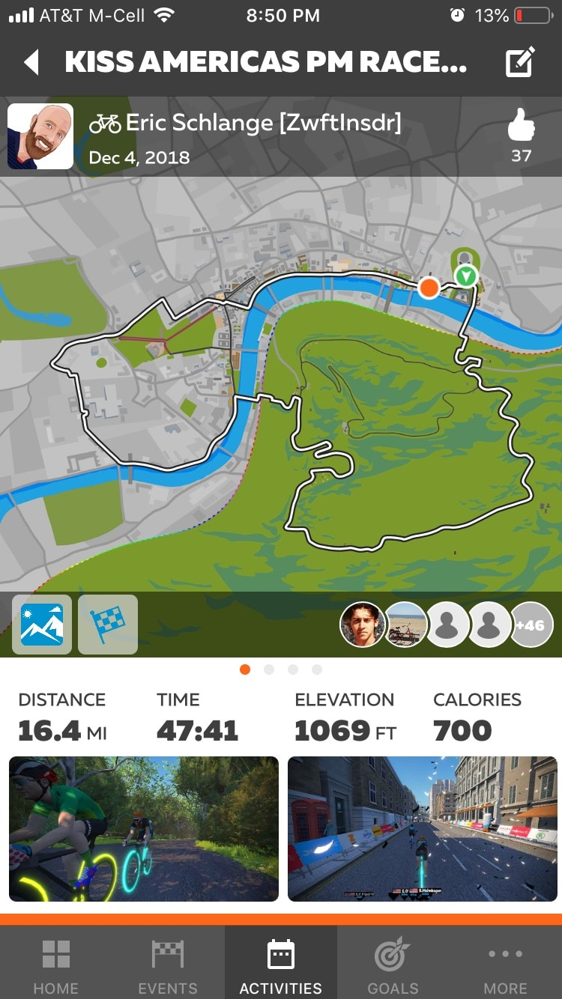 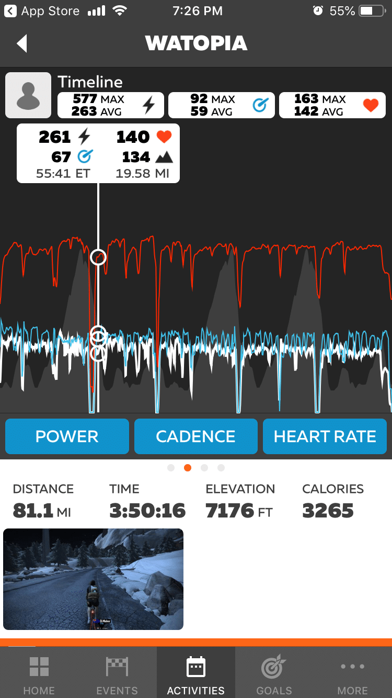
*Companion activity detail (2018 layout, still the same structure). Left: map and totals. Right: scrubbing timeline with max/avg for power, cadence, HR.*

**Complaints:** older rides beyond 250 drop off (t/589101, 2022); rides that fail to save or arrive corrupted (t/661847 Dec 2025, t/671840 Oct 2026, outage t/670119 Aug 2026); delete has no undo.

---

## 5. Sitemap

### 5.1 Zwift today

```
ZWIFT GAME (PC, Mac, iOS, Android, Apple TV)
├─ Launcher: email, password, Remember me, Forgot password, Create account
│   └─ Welcome: plan status, CHANGE USER, LET'S GO
├─ First launch only: license → about you → goals → pairing → gender → body → avatar → bike
├─ Paired Devices (or a background "looking for equipment" toast)
├─ HOME  [tabs: Home | Events | Routes | Workouts]
│   ├─ Home: next-event hero, progress card (weekly goal, XP, badges), For You, What's New
│   ├─ Events: schedule, sign up
│   ├─ Routes: world, route list (time estimate from FTP + weight) → START RIDE
│   ├─ Workouts: Collections / Custom / All / Plans → overview → START RIDE → route → START WORKOUT
│   └─ Top right: Join a Zwifter · Pairing · Garage · Initials menu
│        (Achievements · My profile · My settings · Tutorial · Switch to running) · Exit
│        My settings tabs: Preferences · Audio & Video · HUD · Hardware · Permissions
├─ RIDING: HUD + action bar + MENU (Esc) → End Ride, profile, badges, settings
└─ AFTER: Ride Report → Save → Progress Report → Home

ZWIFT COMPANION (phone)
├─ Home: stats strip, Zwifting Now, Today, Weekly Goal / Training Score, What's New, Explore, Recent activities
├─ Events · Plan (schedule + to-do list; AI Coach on Zwift Plus) · Clubs
├─ More: Profile, Find Zwifters, Leaderboards, Settings → Connections, Equipment, Shop, Help, Forums
└─ While riding: Map, Dashboard, Zwifters, Messages, workout controls

ZWIFT.COM
├─ Sign in / Create account → profile wizard → membership
├─ /feed: activities (Everyone / Just Me) → activity → title, visibility, Download FIT; Fitness box + power curve
├─ Account → Profile · /settings/connections · Membership & billing · Shop orders
└─ /racing/me (Racing Score)
```

### 5.2 Suggested Weem Watts sitemap (one app, one tab, no account)

```
WEEM WATTS (browser)
├─ First visit only: Who's riding? → Your numbers (units, weight, FTP) → Connect trainer
├─ Ride        live numbers, controls, End Ride → Ride Summary (same tab)
├─ Workout     1. course  2. workout  (+ builder)
├─ Rides  NEW  list of past rides → Ride Summary → Download FIT · Rename · Delete (with undo)
└─ Profile     rider switch NEW · numbers · weekly goal NEW · power bests NEW
               · settings (units, sounds) · your files · Back up / Restore NEW
```

---

## 6. The ride in three phases

### 6.1 Pre-ride

**Zwift clicks (free ride):** open app → LOG IN (1) → LET'S GO (2) → devices auto-pair or OK (3) → Routes tab (4) → pick route (5) → START RIDE (6). A workout adds Workouts tab → collection → workout → START RIDE → route → START WORKOUT, about 8 clicks.

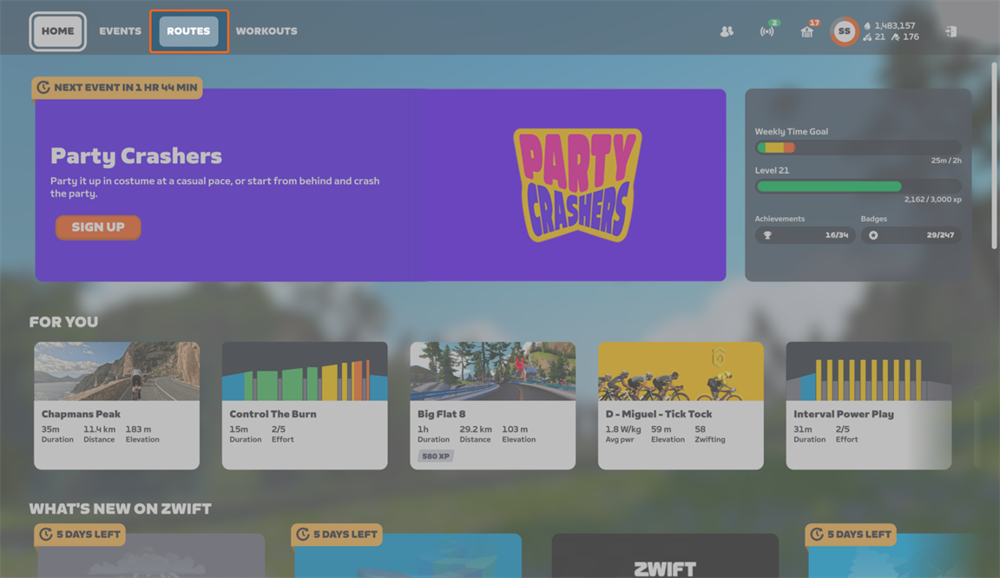
*Home with the four text tabs (v1.122).*

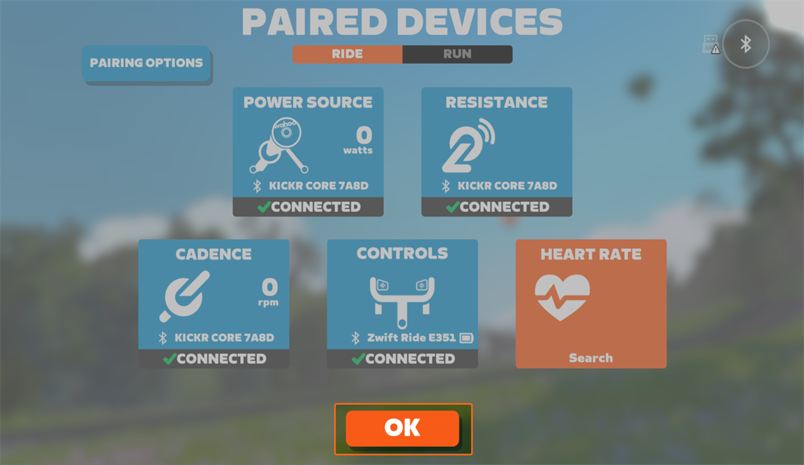
*Pairing: one tile per signal (power, resistance, cadence, controls, heart rate), each with a live value and Connected or Search.*

**What's good:** route time estimates from your FTP and weight; one tile per sensor with a live number; background pairing that skips the screen once devices are known.

**Weem Watts today:** Connect → pick Kickr → Start ride (3 clicks), plus the Workout tab when you want a course or workout. Already shorter than Zwift.

### 6.2 In-ride

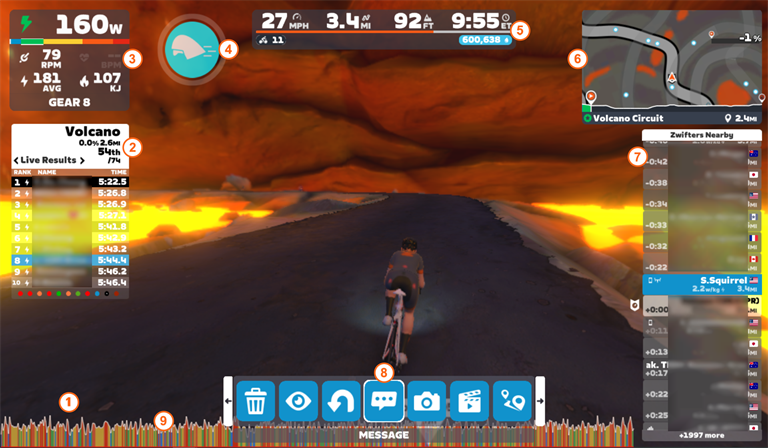
*Free-ride HUD (v1.93): power panel top left, speed / distance / climb / time top centre, minimap top right, riders list right, action bar bottom.*

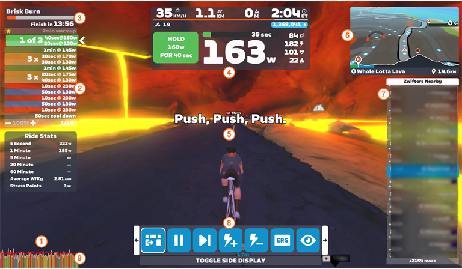
*Workout HUD (v1.113): "HOLD xW FOR x sec" target tile next to live power, block list with stars, countdown bar.*

Key pieces: big live power with zone colour, 4 pickable data slots, dynamic climb view (next ~800 m), Splits (manual laps), Ride Stats (best 5 s to 60 min), H to hide the HUD, G for the graph. Full inventory is in `docs/zwift-ride-experience-research.md`.

**Ending the ride:** MENU (bottom left) → END RIDE. Ending from the phone app skips the Ride Report.

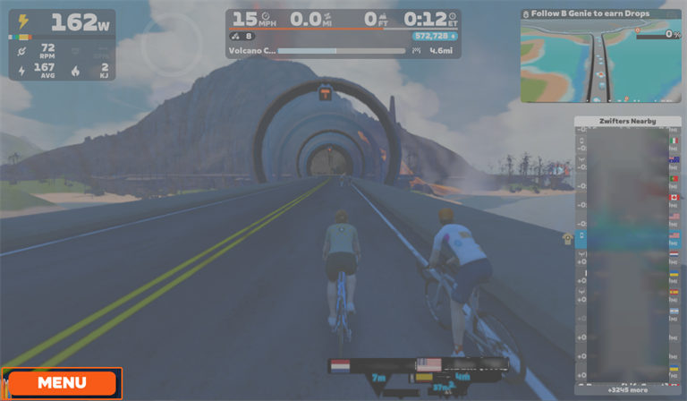

### 6.3 Post-ride (what happens right after you stop)

| # | Screen | What's on it | Clicks |
|---|---|---|---|
| 1 | **Ride Report** | Title "Zwift – <Route> in <World>", avg power, distance, time, kcal, Ride Ons, XP bar. Tabs: **General** (route map, Rode With + follow buttons, goal bar, highlights like "Achievement unlocked" or new power bests), **Timeline** (power, cadence, HR by the second, Stress Points), **Critical Power** (power curve). | OK (auto-selects after a countdown) |
| 2 | **Save** | Title field, visibility (Public / Followers / Private), share to club, pick photos, SAVE, and a trash can to discard | SAVE |
| 2a | Discard confirm | "This activity will be permanently deleted…" Cancel / Discard | - |
| 3 | **Progress Report** | Career (level, XP this ride, bike upgrade progress, achievements, route badges), Fitness Trends (weekly goal bar, week streak, distance / elevation / energy totals, Training Score + status), Performance (1-year bests 5 s / 1 / 5 / 20 min with PR badge, FTP, Race Score). Camera icon saves it as an image | CONTINUE (auto) |
| 4 | Home | Back where you started. FIT already uploading to zwift.com, then Strava / Garmin | - |

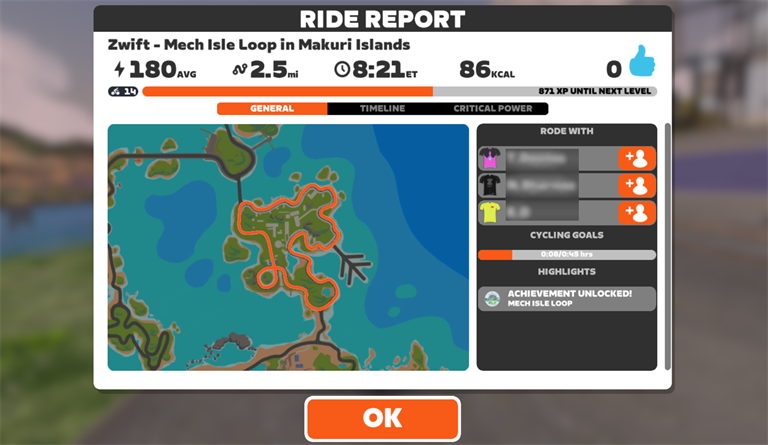
*Ride Report, General tab (v1.101).*

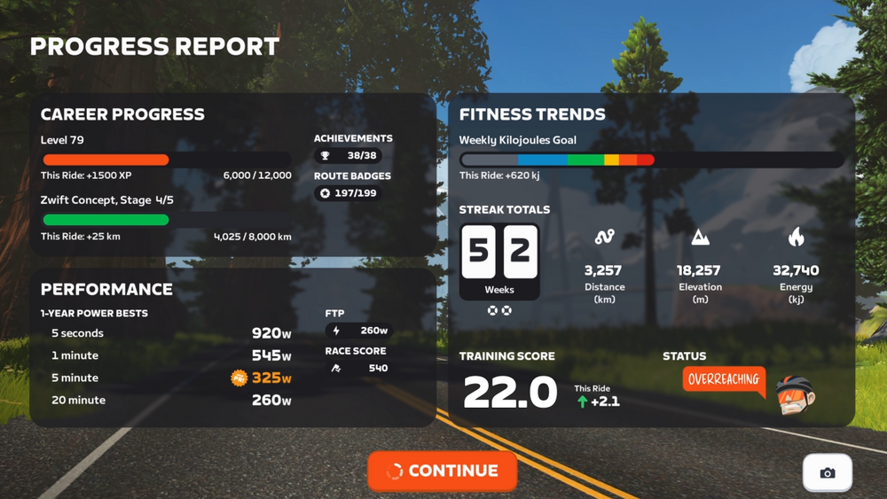
*Progress Report (Dec 2025, v1.104). The "PR" badge on 5-minute power is the reward moment riders notice.*

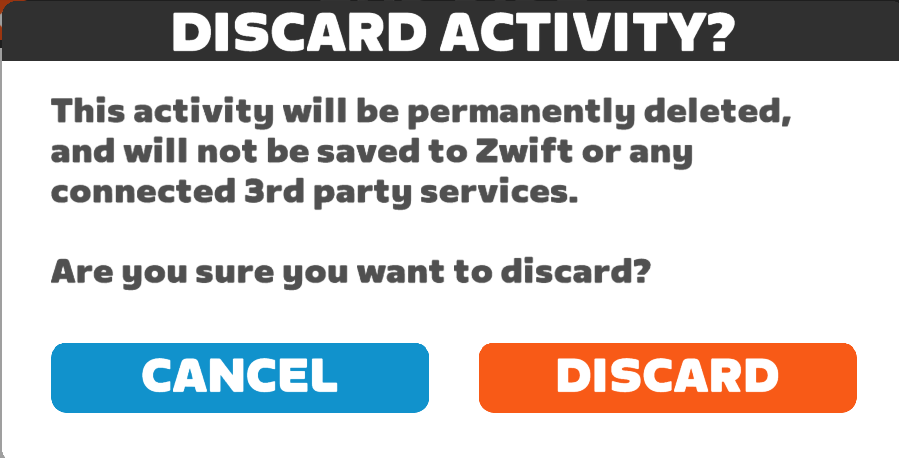
*The discard dialog. A rider deleted a race by accident on this screen and asked for a 2-hour trash bin (forum, Sept 2026).*

**How it feels:** a quick reward loop (numbers, a map, XP filling, a PR badge), then out. Most riders hit OK, SAVE, CONTINUE in under 30 seconds and look at details later on Strava or the phone.

**Where it goes wrong:**
- Discard sits next to Save with no undo
- Saving can hang or lose the ride on a bad connection (most-voted request ever: "Allow Saves Without Exit", 1,358 votes)
- Average power counts Coffee Stop zeros (forum, Nov 2026)
- Achievements flash for 5 seconds and are hard to find again

**Weem Watts today:** End Ride → Confirm end → FIT downloads → panel shows dashes with Download FIT and New ride. No summary at all. This is the biggest gap.

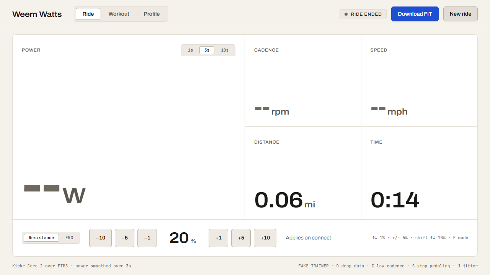

---

## 7. What riders love and hate

**Love**
1. Seeing the road ahead (dynamic climb view, route minimap)
2. Big live power with zone colours and a time-in-zone bar
3. Workout player: target tile, countdown, block list with stars
4. Rewards: XP bar, PR badges, streaks, weekly goal
5. Ghosts of your own best (HoloReplay: ride against your PB on a route or segment)
6. Auto-upload to Strava
7. Social group rides (out of scope for you)

**Hate**
1. Price and the Zwift Plus upsell ($29.99/mo, Oct 2026)
2. Dropped connections and a flaky second app (Companion)
3. Rides that don't save, or save corrupted
4. Clutter: HUD you can't rearrange, Companion panels you can't hide
5. Stats scattered over game, phone and web
6. Login pain on shared trainers, no family plan
7. Forced updates and changes mid-season

---

## 8. Replicate vs leave out

| Zwift thing | Call | Why |
|---|---|---|
| Required account with email + password | **Leave out** | Weem Watts works with no account. That is a selling point |
| Social login (Google, Strava) | **Later, optional** | Only if you add cloud sync. Never required to ride |
| Profile numbers (weight, FTP, units, max HR) | **Replicate** | Already have most. Add units and max HR when HR lands |
| Name, birthday, gender, country, avatar | **Leave out** | Only matter for public leaderboards and 3D avatars |
| "Change user" for shared trainers | **Replicate, better** | Local rider picker, no password |
| Ride Report (summary after the ride) | **Replicate** | Biggest gap today |
| Save screen + discard | **Simplify** | Rides already autosave. Just a name field. Delete lives in history, with undo |
| Progress Report | **Replicate a light version** | Power bests, PR badges, weekly goal, streak. Skip XP, Drops, levels |
| Activity history (250 cap) | **Replicate, no cap** | IndexedDB list of every ride |
| Download FIT per ride | **Replicate** | Already have the writer |
| Auto-upload to Strava | **Later** | Needs a server function (already in the Later list) |
| Activity feed, Ride Ons, comments, clubs | **Leave out** | No social |
| Companion phone app | **Leave out** | One app is a feature. Riders hate needing two |
| Achievements / route badges | **Maybe later** | A few personal milestones (first 100 miles, finished a course) could be fun. Not now |
| HoloReplay ghost of your best | **Replicate later** | Already planned in v3.3 |
| Garage, Drops, XP, levels, Racing Score | **Leave out** | Game economy and racing, not training |
| AI coach, plans, paywall | **Leave out** | Price is the #1 complaint |

---

## 9. Build list

In order. Every item is browser-only and fits the no-server rule.

### 1. Ride Summary (after End Ride)
- **What:** End Ride → Confirm → the Ride tab turns into a summary. Top: ride name (editable, default "Course · Workout · Date"), time, miles, climbing, avg W, normalized W, kJ, avg cadence. Middle: power + cadence (+ HR later) line chart over the ride, workout intervals shaded, time-in-zone bar. Bottom: best 5 s / 1 / 5 / 20 min with a **PR** tag when it beats your history.
- **Buttons:** Download FIT (primary), Ride again (same course + workout), New ride. No discard here.
- **Done when:** a fake ride ends and shows the summary with every number filled; Download FIT still works; Ride again loads the same setup.

### 2. Rides tab (history)
- **What:** a list of every saved ride, newest first: date, name, course / workout, time, miles, avg W. Click opens the same Ride Summary. Each row: Download FIT, Rename, Delete.
- **Delete:** moves to "Recently deleted" for 7 days with Restore. Fixes Zwift's no-undo complaint.
- **Done when:** 3 test rides show in the list, one can be renamed, deleted and restored, and FITs download from old rides.

### 3. Progress card
- **What:** on Profile (and at the bottom of each Ride Summary): weekly goal bar (hours, miles or kJ, you pick), week streak, power curve all-time vs last 60 days, current bests. The ramp test result updates FTP and logs it with a date.
- **Done when:** after two rides the bar moves and a new best shows a PR tag.

### 4. Who's riding (local riders)
- **What:** a small rider chip in the top bar. Click → list of riders on this browser → pick one or Add rider. Each rider has their own profile numbers, rides, workouts and last setup. No passwords.
- **Done when:** two riders on one laptop keep separate FTPs and ride lists.

### 5. First-visit setup (3 screens)
- **What:** 1) Name your rider, units, weight, FTP (or "I don't know, use 200 W and take the ramp test later"). 2) Connect your trainer, with the "close Zwift and the Wahoo app first" tip. 3) Pick Free ride or a workout. Progress dots at the top like Zwift's wizard. Skippable.
- **Done when:** a fresh browser goes from landing to riding in under a minute.

### 6. Back up and restore
- **What:** Profile → "Back up everything" downloads one file (profile, riders, rides, workouts, courses). "Restore" loads it. "Download all FITs" zips every ride.
- **Why:** browser storage can be wiped. This is your stand-in for a cloud account.
- **Done when:** back up, clear site data, restore, and everything is back.

### 7. Settings group on Profile
- **What:** units, sounds on/off (interval beeps), default trainer mode, power smoothing. One short list, not five tabs.

### 8. Later: optional sign-in (only if you go public)
- **What:** "Continue with Google" and "Connect Strava" (Strava OAuth doubles as auto-upload), or an email magic link. Signing in only syncs; riding never needs it.
- **Needs:** a Vercel function plus a small database. Waits for the "going public" decision per the scope guardrails.

---

## Sources

**Zwift support** (support.zwift.com): Creating an Account; Downloading and Launching Zwift; Launching Zwift for the First Time; Account FAQ; Joining Zwift FAQ; Updating Your Public Profile; Zwift Companion App Home Screen and Menu; Your Activities in Zwift; Locating Your Activity, Log, and Workout Files; My Activity Didn't Upload; Zwift and Third-party Platforms; Your Ride Report; Your XP and Level; Racing Score FAQ. All read 20 Nov 2026.

**zwift.com:** /us/sign-in (Email, Password, Remember me only; checked 20 Nov 2026); /companion.

**Zwift newsroom:** "These two updates will improve your Zwifting experience" (Progress Report, 16 Dec 2025).

**Zwift forums** (forums.zwift.com/t/<id>): 672193 Companion v3.91 (Oct 2026); 664467 Companion layout (Jan 2026); 630676 achievements scattered (May 2024); 589101 250-activity limit (2022); 670119 save outage (Aug 2026); 661847, 671840 lost or corrupted rides; 240296, 608831, 671261 shared trainers and Apple TV logins; 571882, 646468, 606276, 611983 login bugs; 568865, 632233, 633059 two-factor requests; 13112 family plan; 13113 save without exit.

**Zwift Insider:** Planning launch (23 Apr 2026); Activity Feed in Companion 3.0 (Dec 2018); Power graph on web profiles (Mar 2023); Route badges (Sep 2026).

**Strava help:** "Zwift and Strava" (21 Sep 2026).

**Earlier Weem Watts research:** `docs/zwift-complaints-research.md` (complaint counts, votes), `docs/zwift-ride-experience-research.md` (HUD, workout player, Ride Report and Save details).
